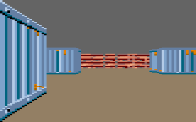

# wallscaler — a maze walked with the joypad



The engine's raycasting (`engine/graphics/raycast`, manual :
[raycast.md](../../docs/lang/en/raycast.md)) : `raycast.cast` casts a ray a
screen column in the map, `wallscaler.draw` draws the walls by compiled
scalers. Left and right turn, up and down walk.

`src/` holds the game mode, the boot, the textures and the map ; the
scalers and the raycaster's tables are generated by `<wallscaler>` and
`<raycast>`.

## Build and run

```
cd examples/wallscaler
ln -s ../../engine engine        # once
java -Dbasedir=../.. -cp "../../repo/*" com.widedot.m6809.gamebuilder.MainCommand -f to8.config.xml
```

| disk | view |
|---|---|
| `dist/to8.fd` | the whole screen, 80 x 200, the default settings |
| `dist/to8-view.fd` | 64 x 128 in the middle of the screen, a test card around it |
| `dist/to8-fine.fd` | the same view with `lines` 1, `clipstep` 4, `fov` 90, `wall` 1.0, `pair` false |

## Bench

```
python3 ci/toje-bench/bench.py examples/wallscaler
```

33 tests a disk : for 16 cameras the column descriptors' sum and the
view's sum, then the screen outside the view, which must not change.
`BenchReferenceTest` (`toolbox/graphics/raycast`) makes the same sums from
the builder's model.

Result (toje, 14/11/2026) : 33/33 on the three disks.

| | `to8.fd` | `to8-view.fd` | `to8-fine.fd` |
|---|---|---|---|
| `raycast.cast`, cycles | 44 400 | 36 400 | 50 500 |
| `wallscaler.draw`, cycles | 53 500 | 33 700 | 37 100 |
| frames a second | 9.3 (6.2 - 12.5) | 12.1 (10.0 - 16.5) | 10.0 (8.2 - 12.5) |
| scalers | 64 472 bytes, 4 pages | 27 952, 2 pages | 38 374, 3 pages |

## Pictures

`src/textures.png` : a brick wall and the side of a shipping container, 64
x 64 each, in 16 colours of the TO8. Its palette is the game's ; colours 1
and 2 are the ceiling and the floor.

`src/map.png` : a pixel a cell, colour index 0 empty, 1 and 2 a wall of
that texture.
