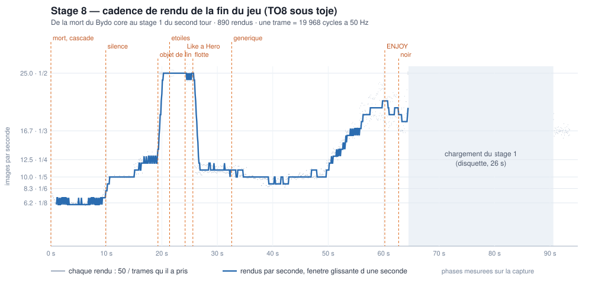

# Profil de la fin du jeu (stage 8) — 17/10/2026

Mesuré sous toje par `tools/ending_profile_probe.py` (cadence : relevé de
budget sur `stage.loop` ; étapes : `run_until_pc` de frontière en frontière
et `total_cycles` de l'anneau de trace, quatre rendus). Une trame TO8 vaut
19 968 cycles à 50 Hz.

## La cadence

| Phase | Images par seconde |
|---|---|
| cascade d'explosions du noyau (0–10 s) | 6,2 (8 trames par rendu) |
| défilement, fondu du décor (10–19 s) | 10 puis 12,5 |
| étoiles seules (19–26 s) | 25 |
| flotte + générique (26–50 s) | 10, 8,3 au plus chargé |
| la flotte sort (50–64 s) | 12,5 à 20 |
| chargement du stage 1 | 26 s sans rendu |

## Un rendu à pleine charge

Huit lignes de générique à l'écran, la flotte entière : 100 578 cycles,
5,04 trames (10 images par seconde).

| Étape | Cycles | Part |
|---|---|---|
| `RunObjects` — dont le rattrapage de la fin : 33 200 | 38 382 | 38,2 % |
| effacement du champ (`clearBlast`) | 23 386 | 23,3 % |
| générique (`credits.Draw`, 8 lignes compilées) | 19 740 | 19,6 % |
| `BuildSprites` (18 R-9, le vaisseau) | 10 214 | 10,2 % |
| colonnes noires (`viewport`) | 5 176 | 5,1 % |
| étoiles (`starfield.draw`) | 1 370 | 1,4 % |
| fondu, joueur, pod, bits | 1 013 | 1,0 % |
| collisions | 611 | 0,6 % |
| le reste (manette, défilement, vague, verrou, `endTick`) | 692 | 0,7 % |

Les IRQ 50 Hz tombées pendant les étapes y sont comptées : 318 cycles d'une
trame ordinaire, jusqu'à 848 quand le lecteur YMM a plus à faire.

`RunObjects` en détail : rattrapage 33 200 cycles pour k = 5 trames arcade
(≈ 6 600 par trame : le directeur et les 18 vaisseaux rejoués pas à pas),
publication 3 773, les autres objets 260.

## Après correction (17/10/2026, un rendu à pleine charge)

| Étape | Avant | Après |
|---|---|---|
| `RunObjects` | 38 382 | 2 242 |
| effacement du champ | 23 386 | 22 662 |
| générique (8 lignes) | 19 740 | 21 088 |
| `BuildSprites` | 10 214 | 7 711 |
| colonnes | 5 176 | 5 748 |
| **rendu entier** | **100 578 (5,04 trames)** | **63 038 (3,16 trames)** |

- **La flotte est précalculée** : `tools/gen_ending.py` la fait voler depuis
  la ROM (fractions de départ de la borne prises dans la référence MAME) et
  n'en garde que les changements à l'écran — 3 372 enregistrements, 10 Ko,
  fichier `stage8.fleet`. Par rendu et par vaisseau : une comparaison de
  l'horloge à l'échéance suivante, quelques chargements quand elle est
  passée (`fleet.unit.asm`), quel que soit le nombre de trames rattrapées.
  Vérifiée identique à la borne trame par trame (`gen_ending.py --check`,
  1 987 trames) et, sous toje, créneaux de la flotte égaux aux tables sur
  toute sa vie.
- **L'effacement ne touche plus que l'intérieur du viewport** pendant la fin
  (`ending/clear.asm`, colonnes sautées : ≈ 450 cycles de moins). Le loger
  dans le `clearBlast` commun débordait l'arène des objets communs.
- Les petites variations d'une étape à l'autre viennent des IRQ tombées
  pendant elle.

Reste à passer sous 3 trames (59 904 cycles) pour un rendu en 3 trames au
lieu de 4.

## Ce qui n'était pas normal (avant correction)

1. **Le rattrapage de la flotte** (33 % du rendu) : chaque rendu rejoue les
   k trames arcade écoulées, une par une, pour 18 vaisseaux. Le corps d'une
   trame est sans effet de bord hors des changements d'entrée de script : la
   règle de l'auteur (« boucles par trame = multiplications ») s'applique —
   avancer de k trames d'un coup, ne découper qu'aux frontières d'entrée.
   Et c'est un cercle : plus le rendu est lent, plus k grandit.
2. **L'effacement du champ entier** (23 %) : 144 × 180 pixels effacés à
   chaque rendu alors que le champ est noir, hors des étoiles, des lignes de
   texte et des vaisseaux.

Le reste est à sa place : le générique coûte ce que le comptage statique
annonçait (15 700 cycles de lignes + le parcours des 48 rangées et le calcul
des positions), la flotte 570 cycles par vaisseau, les colonnes 5 121.
