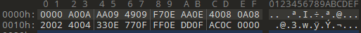

/[index]/[toolbox]/png2pal

[index]: ../../../readme.md
[toolbox]: ../../../docs/toolbox.md

# png2pal
## Description
Process one or more PNG files to extract and convert indexed palette data :
- PNG PLTE chunk is read from an offset index and for a number of colors
- Each color is converted by using a specified profile in CIE Lab color space
- Output file(s) are generated based on one of three availaible modes

### Profiles
Only one profile is available for now, his name is "to".
Profile is stored in the root directory of plugin jar file and contains a list of available colors.

### Modes
#### obj
Generate assembly code in lwasm object format :
symbol is optional, if not provided it will be replaced by the filename, minus his extension.

    pal.score EXPORT

    SECTION code
    pal.score
            fdb   $0000 ; GR0B (0,0,0,0)
            fdb   $f00f ; GR0B (255,49,0,255)
            fdb   $0000 ; GR0B (0,0,0,0)
            fdb   $ff0f ; GR0B (255,255,0,255)
            fdb   $f50f ; GR0B (255,165,0,255)
            fdb   $0000 ; GR0B (0,0,0,0)
            fdb   $0001 ; GR0B (0,0,0,107)
            fdb   $0000 ; GR0B (0,0,0,0)
            fdb   $000c ; GR0B (33,0,0,222)
            fdb   $200e ; GR0B (132,16,0,255)
            fdb   $0000 ; GR0B (0,0,0,0)
            fdb   $0000 ; GR0B (0,0,0,0)
            fdb   $0000 ; GR0B (0,0,0,0)
            fdb   $0000 ; GR0B (0,0,0,0)
            fdb   $0000 ; GR0B (0,0,0,0)
            fdb   $0000 ; GR0B (0,0,0,0)
    ENDSECTION


#### dat
Generate assembly code in lwasm raw format.
symbol is optional and will not show in code if not set.

    pal.score
            fdb   $0000 ; GR0B (0,0,0,0)
            fdb   $f00f ; GR0B (255,49,0,255)
            fdb   $0000 ; GR0B (0,0,0,0)
            fdb   $ff0f ; GR0B (255,255,0,255)
            fdb   $f50f ; GR0B (255,165,0,255)
            fdb   $0000 ; GR0B (0,0,0,0)
            fdb   $0001 ; GR0B (0,0,0,107)
            fdb   $0000 ; GR0B (0,0,0,0)
            fdb   $000c ; GR0B (33,0,0,222)
            fdb   $200e ; GR0B (132,16,0,255)
            fdb   $0000 ; GR0B (0,0,0,0)
            fdb   $0000 ; GR0B (0,0,0,0)
            fdb   $0000 ; GR0B (0,0,0,0)
            fdb   $0000 ; GR0B (0,0,0,0)
            fdb   $0000 ; GR0B (0,0,0,0)
            fdb   $0000 ; GR0B (0,0,0,0)

#### bin
Generate binary data of converted palette values only.



## Usage
This tool is available as a plugin for the builder or as an independant program.

### Plugin

The plugin name is : png2pal

**syntax :**

    <png2pal symbol="pal.title" filename="src/assets/objects/title/logo/resources/logo.png"     gensource="src/assets/palettes/title/pal.asm"/>

| attribute   | default                | values              | description                                                     |
| ----------- | ---------------------- | ------------------- | --------------------------------------------------------------- |
| filename    |                        | *file or dir name*  | input file or directory for png files                           |
| mode        | obj                    | obj, dat, bin       | generator mode                                                  |
| profile     | to                     | to                  | profile name for color conversion                               |
| offset      | 1                      | 0-255               | color index offset in source palette                            |
| colors      | 16                     | 1-256               | number of colors to convert                                     |
| symbol      | *filename<sup>1</sup>* | *lwasm symbol*      | asm symbol to place in front of data (for *obj* and *dat* mode) |
| gensource   | *filename<sup>2</sup>* | *file or dir name*  | output file or directory for generated files                    |
| format      | png                    | png, rgb12          | input : the PNG's palette, or big endian $0RGB words            |
| palettes    | 1                      | 1-n                 | rgb12 : palettes of *colors* words in the file, one table        |
| lift        |                        | black,from,floor    | the darks spread above the TO8's first level (L*)               |
| darkest     | keep                   | keep, black         | the darkest colour of each palette written black                |

<sup>1</sup> without extension
<sup>2</sup> with mode specific extension (.asm or .bin)

### Palettes of 12-bit words : `format="rgb12"`

An Amiga or Atari ST game keeps its palettes as big endian `$0RGB` words, 4 bits a
component (component *c* is *c* x 17). `format="rgb12"` reads them from the start of
`filename`, `palettes` palettes of `colors` words, and converts them into one table,
palette after palette (`offset` does not apply).

### Darks the TO8 cannot show : `lift` and `darkest`

The TO8's first level above black is already 97/255 (L* about 41) : every dark colour of a
picture meets there, and dark details melt. Two options, by palette :

- `lift="black,from,floor"` : before the search, a colour's lightness L* from..100 is
  spread to floor..100 ; a colour at most black (L*) keeps it. The darks stay apart, the
  picture gets lighter.
- `darkest="black"` : the darkest colour of each palette is written black.

`lift="5,15,42" darkest="black"` is the conversion Another World's v1 port chose
(its choice D). With either option the search runs on Lab values as computed and the exact
CIEDE2000 (the default path rounds Lab to whole numbers and uses a fast atan2) : the levels
are that port's, to the bit (`Rgb12Test`, against its code run on the 4096 colours by
`src/test/resources/gen_rgb12_reference.py`).

```xml
<png2pal symbol="Pal_water" filename="data/res/026.bin" format="rgb12" palettes="32"
         lift="5,15,42" darkest="black"/>
```

### Command line
Command line use the same parameters as the ones used by plugin.
For Windows users, add .bat to the script name.

**syntax :**

    png2pal -f=<filename>

    Process one or more PNG files to extract and convert indexed palette data

    -f, --filename  Process a png input file, or all png files in a directory
    -m, --mode      Conversion mode (obj (default), dat, bin)
    -p, --profile   Color profile (to (default))
    -o, --offset    Color index offset, determines the starting color index (default to 1, index 0 is gennarally assigned to transparent color)
    -c, --colors    Number of converted colors (default to 16)
    -s, --symbol    Symbol name in asm (default to filename minus extension)
    -g, --gensource Output asm file name (default to filename with specific mode extension)


